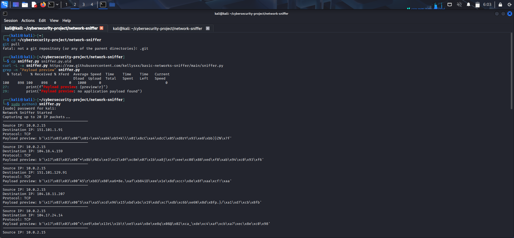
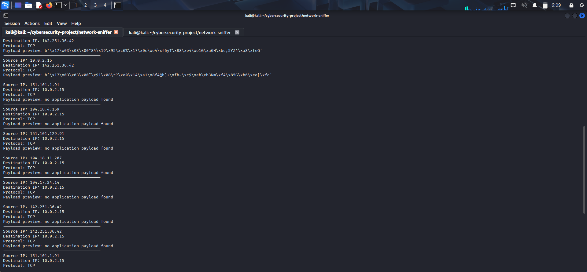
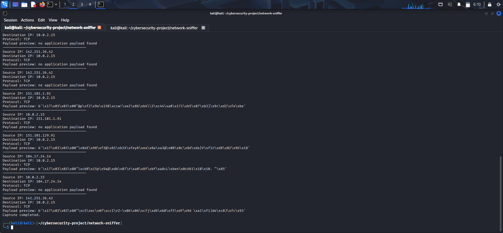

# Basic Network Sniffer

A beginner Python packet sniffer built with Scapy in Kali Linux. It captures a limited number of IP packets and displays their addresses, transport protocol, and a short payload preview when one is available.

## Tools

- Kali Linux
- Python 3
- Scapy
- VirtualBox

## Features

- Captures up to 20 IP packets
- Displays source and destination IP addresses
- Identifies TCP, UDP, and ICMP traffic
- Prints up to 32 bytes of packet payload when available
- Keeps capture output in the terminal and does not save packets to a file

Payload previews may contain encrypted or binary data. HTTPS traffic is encrypted, so the preview is not a readable message. Some packets do not contain an application payload.

## Evidence







## How to Run

Install Scapy in Kali Linux if needed:

```bash
sudo apt update
sudo apt install python3-scapy -y
```

Run the sniffer:

```bash
sudo python3 sniffer.py
```

To generate test traffic, open a second terminal and run:

```bash
ping -c 10 1.1.1.1
```

The sniffer stops after capturing 20 IP packets.

## Example Output

```text
----------------------------------------
Source IP: 10.0.2.15
Destination IP: 1.1.1.1
Protocol: ICMP
Payload preview: b'...'
----------------------------------------
Source IP: 1.1.1.1
Destination IP: 10.0.2.15
Protocol: ICMP
Payload preview: b'...'
Capture completed.
```

Actual addresses and payload bytes depend on the traffic captured.

## What I Learned

I learned how to capture IP packets, identify source and destination addresses, distinguish common protocols, and inspect a bounded payload preview with Python and Scapy.

## Disclaimer

This project is for learning purposes. Only capture traffic on networks and devices you own or have permission to monitor.
